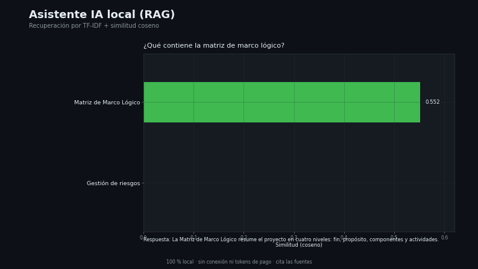

# Capa 9 — Asistente IA local (RAG)

[`lazarolpro/proyectia-asistente`](https://github.com/lazarolpro/proyectia-asistente) · parte del [portafolio de 9 capacidades](https://github.com/lazarolpro/portafolio)

**Capacidad demostrada:** construir un asistente que responde sobre una base de
conocimiento propia mediante **recuperación aumentada (RAG)**, sin depender de APIs
externas ni de la nube: recupera los pasajes relevantes y cita las fuentes.

> © 2026 Ronny L. Díaz López. **Todos los derechos reservados.** El código fuente,
> los datos de detalle y los informes completos son propiedad del autor y no se
> publican. Prohibida su venta o uso comercial sin autorización escrita. Ver
> [`LICENSE`](LICENSE).

## Problema real

Buscar en manuales, procedimientos o documentación de proyecto a mano consume
tiempo y se pierde el contexto. Un asistente RAG local responde con la información
correcta, **citando de dónde sale**, y funciona 100 % offline.

## Qué hace

- Indexa una base de conocimiento local con **TF-IDF**.
- Recupera los pasajes más relevantes por **similitud coseno**.
- Compone una **respuesta extractiva** citando las fuentes y su puntuación.
- Funciona sin conexión y sin tokens de pago.

## Demo visual

La animación muestra, por consulta, las fuentes recuperadas y su similitud. Video
completo: [`assets/asistente_demo.mp4`](assets/asistente_demo.mp4).

## Evidencia que produce

- `assets/asistente_demo.mp4`, `asistente_demo.gif`, `asistente_demo_poster.png` —
  demo visual animado (con miniatura).
- [`assets/muestra_asistente.pdf`](assets/muestra_asistente.pdf) — muestra resumida
  con consultas, respuestas y fuentes (con marca de agua).
- [`data/documentos.json`](data/documentos.json) — base de conocimiento de entrada.
- [`data/consultas.json`](data/consultas.json) — respuestas reproducibles.

## Alcance de este repositorio

Este repositorio es una **vitrina del resultado**: muestra consultas reales, las
respuestas y las fuentes recuperadas. El **código fuente** y los **informes
completos** son propiedad del autor y se mantienen fuera del repositorio público. El
asistente ProyectIA real añade un modelo de lenguaje local (Ollama) para redactar.

## Stack

Python 3 (solo biblioteca estándar: `re`, `math`, `json`, `unicodedata`). Sin
dependencias. *(El código no se publica; ver `LICENSE`.)*

## Por qué le importa a la empresa

Cubre **IA aplicada y automatización del conocimiento**: consultar procedimientos
internos por lenguaje natural, con trazabilidad de la fuente y sin exponer datos a
terceros.

**En mantenimiento:** consultar manuales, fichas técnicas y procedimientos desde el
móvil, en el sitio, sin conexión.
